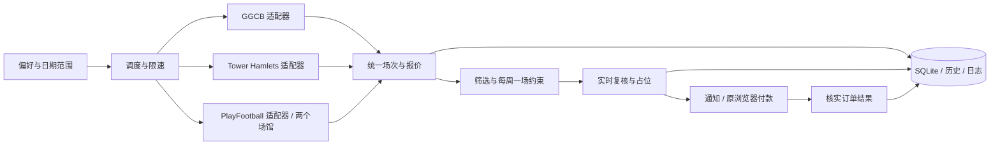
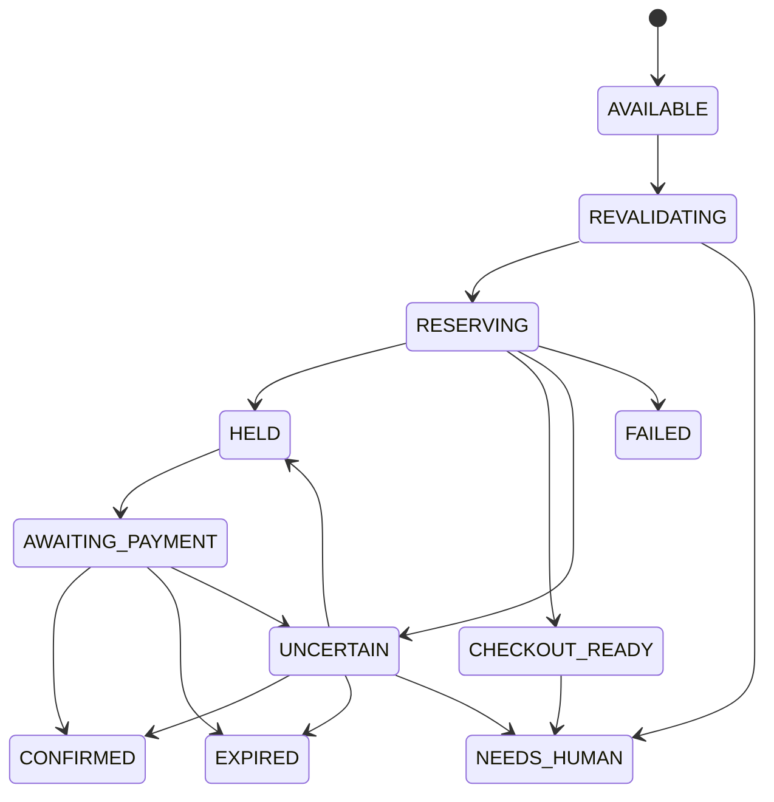

# 场地监测与付款接力：技术框架

日期：2026-10-15，Europe/London。本文件是拟实施设计；当前未部署监测、创建预约或付款。官网事实和条款出处见 [可行性研究](booking-feasibility-research.md)。

## 需求与当前决策

- 本轮搜索范围：2026-10-15 至 2026-12-15；按两个日历月理解。到期停止，后续可另设滚动两个月模式。
- 周一至周四，暂按当地时间 18:00 开始、19:00 前结束；不包含 19:00–20:00。
- 四个入口合计每周最多一场；周按伦敦时间周一至周日计算。
- GGCB 指定半场；Stepney Green 指定三分之一场；Westferry 指定普通 5v5 场（product 85），Poplar 指定普通 7v7 场（product 88）。按用户指定产品租用，不再设置 Westferry 的 6v6 人数核实门槛。
- 全部选择普通单次租场；排除联赛报名、特殊活动、长期包场、订阅及加购。
- 价格采用该日期、该规格、该用户资格对应的公开正常单次租场价格。用户没有设固定英镑上限，不能把“正常价格”实现成任意金额均允许。占位前保存报价，付款前显示含必选费用总价；异常涨价、规格变化、订阅或可选加购转人工。
- 用户已说明 GGCB 半场，但尚未明确回复是否接受实际 55 分钟；将此显示为待确认偏好，不把其伪装成完整 60 分钟。
- 默认持续读取四个入口。只有适用规格、真实占位、付款接力均验证过的适配器才启用自动占位；其他入口继续监测并提示人工操作。

## 已确定的 PlayFootball 产品

| 场地 | 普通单次产品 | 本轮浏览器验证 |
| --- | --- | --- |
| Westferry，product 85 | [5-A-Side 3G Pitch Hire](https://www.playfootball.net/venues/canary-wharf/book-a-pitch/85/5-a-Side3GPitchHire) | 匿名日历和跳转官方 partners 预订摘要通过；翻周未通过；锁位待验证 |
| Poplar，product 88 | [7-A-Side 3G Pitch Hire](https://www.playfootball.net/venues/canary-wharf-poplar/book-a-pitch/88/7-a-Side3GPitchHire) | 匿名日历和跳转官方 partners 预订摘要通过；未来日期覆盖及锁位待验证 |

两个产品均进入 `partners.playfootball.net` 的普通 `Selection Summary`。下一步出现条款勾选和 `Proceed to Checkout`，本轮未接受条款或继续提交。因此还不能宣称到摘要页就锁位，或已验证完整的账户/付款流程。详细操作和限制见 [网站验证记录](website-validation.md)。

## 推荐部署

首版采用单用户本地应用：TypeScript + Node.js、Playwright、SQLite，以及一个轻量本地网页控制台。服务仅绑定 loopback；首版静态 HTML/CSS/少量 TypeScript 即可，不需要前端框架、微服务、Redis 或分布式队列。

运行在用户常开的 Windows 电脑上，用专用、可见的 Chromium 浏览器配置目录。用户首次在浏览器中登录；程序复用会话，出现登录过期、验证码或需要人工同意的结账步骤时提示接管。占位后将原标签页交给用户付款。

Playwright 支持持久化浏览器配置和复用认证状态；应使用工具专用目录，不能并发打开同一 profile，也不直接使用个人日常浏览器默认 profile。[持久化上下文文档](https://playwright.dev/docs/api/class-browsertype#browser-type-launch-persistent-context)、[认证文档](https://playwright.dev/docs/auth)

电脑关机、睡眠或进程退出会中断本地监测。需要真正全天运行时，可后续拆成常开监测服务与本地浏览器执行器；必须先验证两者的会话与订单接力，不能假定云端购物篮链接可在手机或另一台电脑使用。



## 适配器边界

至少三套独立适配器，PlayFootball 两场馆共享代码但分别验证。以下是本工具内部接口，不代表已发现供应商 API：

```ts
interface ProviderAdapter {
  capabilities(): Promise<Capabilities>;
  openManualSession(reason: "login" | "terms" | "payment"): Promise<HandoffResult>;
  checkSession(): Promise<SessionStatus>;
  scan(query: SearchQuery): Promise<ScanResult>;
  revalidate(slot: Slot): Promise<QuoteResult>;
  prepareCheckout(slot: Slot, quote: Quote): Promise<CheckoutResult>;
  attemptHold(checkout: CheckoutRef): Promise<HoldResult>;
  reconcile(attempt: AttemptRef): Promise<BookingState>;
  handoff(checkout: CheckoutRef): Promise<HandoffResult>;
}
```

`Capabilities` 分别记录是否支持扫描、真实未付款占位、到期时间读取、付款接力、订单核实。`unsupported` 和 `unverified` 都是合法结果；不强迫每个站点实现同样的能力。

优先采用官方支持的接口；没有接口文档时，首版通过正常浏览器页面操作。后续若发现网页自身的数据请求，需核实适用条款、认证与稳定性再决定是否使用；不能把它直接描述成公开受支持 API。遇到 429、访问阻断或验证码时退避或交人工，不绕过限制。

页面只显示“Available nearby”时，不算目标场馆有库存；必须核对真实场馆与规格。PlayFootball 当前两个页面的日历时间粒度并不完全相同，不能按固定列位置推算日期、时长。

## 本地控制台和手动登录接口

以下均为设计接口，尚未实现。主页面显示四个资源卡片，三个供应商的会话状态、上次成功扫描、覆盖日期、下次检查、异常原因；提供“打开登录”“检测会话”“恢复任务”“暂停”。下面是统一场次列表、各周已订/待付款名额、待处理事项及简短运行日志。默认只读监测，自动占位按供应商能力单独开启。

后台单进程内划分 HTTP 控制台、调度器、BrowserSessionManager、三个适配器和 SQLite 存储。三系统可各用独立专用 profile；PlayFootball 两场馆共用该供应商 profile，并在同一 context 内保留 www 与 partners 的正常跳转会话。不能假设 www 登录必然覆盖 partners，需要分别检查实际流程。

| 本工具内部端点 | 用途 |
| --- | --- |
| `GET /api/providers` | 返回会话状态、扫描/占位能力和健康状态，不返回 cookie |
| `POST /api/providers/:id/login` | 打开或唤起指定供应商官方登录页，授予用户浏览器操作权 |
| `POST /api/providers/:id/session/check` | 通过官网页面检查会话及预订表单是否可访问 |
| `POST /api/providers/:id/resume` | 用户完成登录后，先检查会话，再从最新库存恢复 |
| `POST /api/providers/:id/pause` | 暂停该供应商任务，不关闭用户正在操作的页面 |
| `POST /api/attempts/:id/handoff` | 唤起本次原预订页，让用户处理条款或付款 |
| `POST /api/attempts/:id/reconcile` | 核对本次订单结果，避免重复占位 |

供应商 id 为固定枚举，登录入口从配置白名单中选择，不接受任意 URL 或浏览器调试指令。localhost 的修改接口检查 Origin/Host 和一次启动会话令牌，防止其他网页驱动本地浏览器。HTTP 只监听 loopback，不向局域网暴露 profile、调试端口或文件下载。

用户操作顺序：点击“打开登录” → 在原网站输入账号、密码和验证码 → 回控制台点击“检测会话/恢复任务”。工具不提供收集密码或验证码的输入框/API。浏览器凭据会话仅在专用本机 profile 中保存，排除 Git、日志、前端响应；不把整个个人浏览器配置导入工具。

`SessionStatus` 区分 `ANONYMOUS_READABLE / AUTHENTICATED / LOGIN_REQUIRED / EXPIRED / UNKNOWN`；另用操作权状态 `AUTOMATION / MANUAL_CONTROL / PAUSED`。没有显示登录框不能证明已登录。用户接管时该供应商的自动点击、导航和刷新全部停止；其余供应商可继续只读扫描，每周一场约束仍然全局生效。检测会话只能读取安全页面，不能刷新用户正在结账的标签页。恢复时重新核对日期、场馆、产品和报价，不重放接管前的提交操作。

Stepney 入口本轮停在账号登录前，适配器首先返回 `LOGIN_REQUIRED`。GGCB 可匿名看日历，是否必须登录结账仍待验证。PlayFootball 可匿名到摘要页，账户是否必选及真实占位发生点仍待验证。条款确认与登录是不同的人工原因，应分别显示。

## 数据与持久化

| 对象 | 最少字段 |
| --- | --- |
| SearchPolicy | dateFrom/dateTo、timezone、weekdays、startTime、durationPolicy、maxBookingsPerWeek、pricePolicy、venuePreferences |
| Resource | provider、venue、product、resourceId（可空）、fraction、advertisedFormat、bookingKind（one_time）、expectedProductLabel |
| SlotObservation | resourceKey、start/end、actualDurationMinutes、availability、observedAt、sourceUrl、scanRunId |
| Quote | slotKey、currency、baseAmountMinor、mandatoryFeesMinor、totalMinor、customerCategory、quotedAt |
| BookingAttempt | attemptId、weekKey、slotKey、state、providerReference、checkoutRef、expiresAt（可空）、expiryEvidence、lastCheckedAt |
| ScanRun / Event | 起止时间、成功/失败、覆盖日期、错误类别、通知去重标识、脱敏证据路径 |

货币用最小单位整数，避免小数误差。场次去重至少包含供应商、场馆、规格/资源、开始和结束时间；URL 中的 product 数字不能假定是全平台唯一物理球场编号。

业务筛选以 Europe/London 的当地日期和时间执行，同时存 UTC 时间戳。每周配额按当地周一日期计算；不能固定以 UTC+0 或 UTC+1 解释 18:00。英国在本次范围内会切换夏令时，应覆盖切换前后各一场验证。[英国时间说明](https://www.visitlondon.com/traveller-information/essential-information/when-do-the-clocks-change)

## 调度与放号

- 普通已开放日期可先采用约 10–15 分钟一轮作为待调优配置，实际服从供应商允许频率；优先一次读取一周/一月，避免逐时段请求。
- 未开放日期记录 `NOT_RELEASED`；无法判定的记 `UNKNOWN`，不冒充已订满。
- GGCB 按“次月提前一周开放”的已知规则安排检查，准确释放日和时刻仍待验证，不硬编码每月某日零点。
- PlayFootball 同时存在官网 30 天与条款通常 28 天的说明，以实际日历确定边界；未来约一个月以外的目标日期等待开放。
- Tower Hamlets 的提前两天表述含义尚待确认；在验证前不编造固定放号规则。
- 放号前后只有在规则和频率允许时才短时提高检查频率；使用每站并发上限、抖动、指数退避。
- 重启后先核对未完成订单，再恢复调度；错过的扫描只补最新结果，不集中重放所有历史请求。

## 占位和每周一场

扫描四个入口可以并行；创建预订必须经过全局周配额协调器。首版用 SQLite 事务和周名额记录，在同一周仅允许一个 `RESERVING/HELD/AWAITING_PAYMENT/CONFIRMED/UNCERTAIN` 尝试占用名额。此限制跨网站生效。

处理顺序为：报价复核 → 原子占用周名额 → 创建一次预订尝试 → 核实供应商结果 → 通知。价格或规格发生变化时转人工。候选排序可先按日期先后、再按四个链接的原始顺序作为可配置默认值，避免等待全部站点成功才处理空位。

仅凭点击按钮、进入购物篮、HTTP 200 或数据库互斥锁，都不能声称供应商库存已保留。`HELD` 需要可核实的供应商订单/保留标识、对应场次和占位依据。到期时间未知则明确显示“到期未确认”，不得用本地计时器伪造完整 30 分钟承诺。



对网络超时后的写入采用“先核对、再决定”，不盲目重复创建订单。结果未明时继续占用周名额，避免另一个网站再订一场。付款确认后该周停止自动占位；过期或失败需先核实再释放名额，并允许设置拒绝后的冷却时间，避免反复抢同一场。

`CHECKOUT_READY` 仅表示结账已准备；无真实占位的网站走通知与人工付款路径。用户付款和必要的条款确认由用户完成。若接受条款发生在占位之前，应将该步骤作为人工门槛纳入站点能力，而非默认自动勾选。

## 付款接力与通知

首版优先桌面通知，展示场馆、日期、时长、规格、含费用总价、占位依据及已知截止时间；“继续付款”唤起原 browser context 的原标签页。只有验证过可恢复订单的官网链接才作为备选，不能只发送场地首页并声称能继续付款。

交给用户后，自动程序停止操作该标签页，避免与付款输入冲突。付款完成依靠官网订单确认页/账户订单记录核实；无法核实时显示待核实，不能靠用户点击通知或网页关闭判定成功。工具不需要保管银行卡或建设自己的 Stripe 收款系统。

后续可接邮件或消息推送，但配置时先确定用户渠道；本轮没有发送外部消息、安装通知渠道或创建定时任务。

认证 profile、cookie、订单令牌与付款链接属于敏感会话数据，限制本地文件权限，排除 Git，日志脱敏。SQLite、截图和日志设置保留期；浏览器 profile 不应被应用前端下载或经公开网络访问。[Playwright 认证安全说明](https://playwright.dev/docs/auth)

## 实施顺序和验收

1. **验证浏览器全流程**：分别核实三个系统的日期范围、规格、真实时长、价格和登录；对用户实际想买的场次验证占位触发、到期和同浏览器人工付款接力。没有沙盒时避免为测试批量占真实库存。
2. **监测版**：实现三个适配器、四入口统一场次、当地时间筛选、变化通知、覆盖日期和健康状态。先只读运行，核对网页与控制台结果。
3. **占位版**：优先 PlayFootball 已有条款依据的流程；通过验证的 GGCB/Council 能力逐一开启。加入每周一场、报价变化检测、超时核对和人工付款接力。
4. **运行维护**：可选 Windows 登录后自启动与进程恢复，明确电脑睡眠时停止；稳定后再评估常开服务器。

必要验证包括：跨夏令时仍为当地18:00；Poplar半小时网格不会误选18:30；GGCB55分钟显式显示；Stepney只选1/3；未放票和失败不显示售罄；两个站点同时发现空位也只产生一次占位；创建请求超时不重复下单；用户付款期间不刷新页面；成功订单不会在重启后再次预订。

在“占位触发点、供应商到期证据、付款接力”三个条件通过之前，产品只承诺监测与协助结账，不承诺一定锁到场地。
